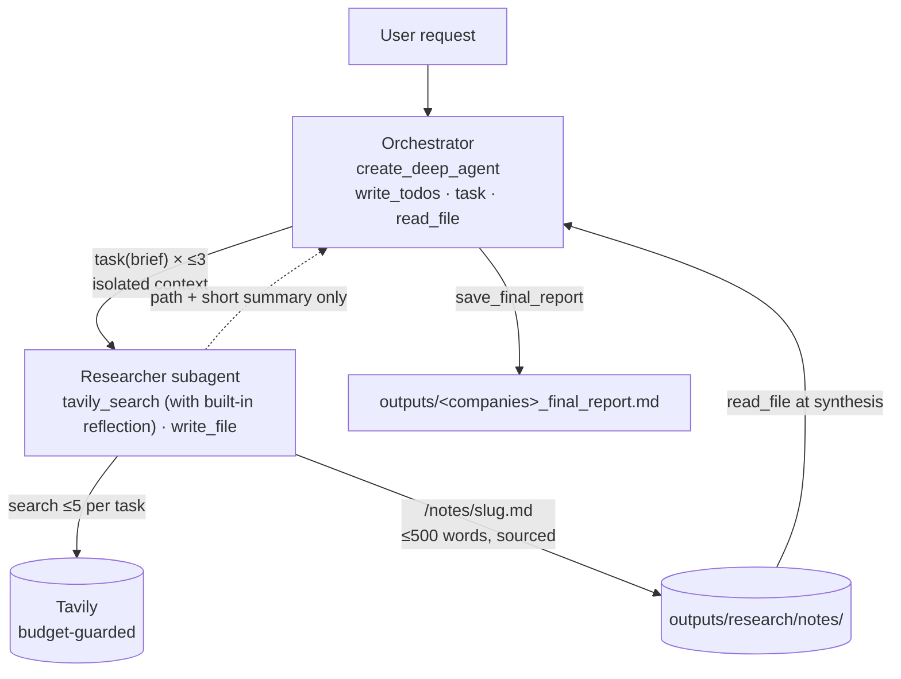

# Financial Company Comparison Agent

A research agent that produces source-backed financial comparisons between companies, built on
[LangChain Deep Agents](https://github.com/langchain-ai/deepagents).

```text
python main.py "Compare Microsoft and Alphabet on revenue growth, profitability, risks and outlook"
```

The agent plans the research, delegates focused tasks to a reusable research subagent that
searches the web through [Tavily](https://tavily.com), stores detailed evidence on a sandboxed
filesystem, and synthesizes a cited markdown report. Every figure keeps its source URL, and
anything unverified, stale or conflicting is flagged rather than filled in.

---

## Why Deep Agents

The system is deliberately **built around the Deep Agents harness instead of a hand-built
workflow graph**. A single `create_deep_agent` call provides the four capabilities that make
long-running research reliable, and the project adds guardrails around them rather than
replacing them.

| Deep Agents capability | How this project uses it |
|---|---|
| **Planning** (`write_todos`) | The orchestrator decomposes the request into the fewest research tasks needed and tracks progress through the built-in todo list. |
| **Subagent delegation** (`task`) | One `researcher` definition is invoked once per focused brief. Each run has an isolated context that contains only its brief. |
| **Filesystem tools** (`read_file`, `write_file`) | Detailed findings are written to disk by the researcher and read back by the orchestrator at synthesis time. |
| **Pluggable backend** (`FilesystemBackend`) | A virtual-mode backend rooted at `outputs/research/` sandboxes all agent file access. |
| **Middleware** (`AgentMiddleware`) | Output limits, scope rules and the delegation budget are enforced in code, around the framework's tools. |

There is no custom state machine, router or retry graph. Control flow comes from the model
operating inside the Deep Agents loop. The code constrains what that loop is allowed to do.

### Context engineering through the filesystem

The central design idea is that **the orchestrator's context stays small while the evidence
stays complete**.



- A researcher's raw search results and intermediate reasoning never enter the orchestrator's
  context. Only a `Notes file: <path>` reference and a short summary are returned.
- The orchestrator must `read_file` every note before it can save the report, so the report is
  synthesized from the evidence and not from summaries.
- Notes persist on disk, which makes every claim in the report traceable and every run inspectable.

---

## Key features

- **Request-driven planning.** Research tasks are derived from the user's request, not a fixed
  template. Dimensions that were not asked for are not researched, and dimensions answered by the
  same sources are merged into one task. The plan is validated in code before any delegation.
- **One reusable subagent.** A single `researcher` specification is reused for every brief
  (financial performance, risks, outlook, or any other focus), not three permanent agents.
- **Hard budgets.** Search limits are enforced in the tool wrapper, not trusted to prompts.
- **Evidence discipline.** Notes and reports preserve source URLs and dates, separate reported
  facts from interpretation, and label calculated ratios as such.
- **Automated report verification.** After saving, the agent checks the report against the
  original request for missing companies, dimensions, sources and uncertainty statements, and
  corrects real gaps (at most two rounds).
- **Observability.** Optional LangSmith tracing plus structured logs of every search, every
  context hand-off between agents, and every note read during synthesis.

## Guardrails enforced in code

| Area | Guarantee |
|---|---|
| Research tasks | At most 3 per request; `task` is refused until a valid plan is accepted. |
| Web search | At most 5 searches per task and 15 per request; `search_depth="basic"`; 4 results; duplicate queries served from cache at no cost; follow-up searches require a stated gap reason. |
| Research notes | Written only to `/notes/<slug>.md`; at most 500 words; five required sections (question, findings, facts, sources, caveats); whole-file replacement only. |
| Subagent reply | At most 500 words; always begins with the verified path of the note that was actually saved. |
| Orchestrator | Cannot write research files itself; cannot save the report until every produced note has been read. |
| Final report | Must be non-empty, contain source URLs and be at most 900 words (enforced in code). |
| Filesystem | Agent file access is confined to `outputs/research/`; `.env` and other repository files are unreachable. |
| Secrets | API keys are read from the environment only and are never logged or printed. |

See [architecture.md](architecture.md) for the full design.

---

## Getting started

**Requirements:** Python 3.11+, an OpenAI API key, and a Tavily API key.

```powershell
# Windows (PowerShell)
python -m venv .venv
.\.venv\Scripts\Activate.ps1
pip install -r requirements.txt
copy .env.example .env      # then add your own keys to .env
python main.py --check
```

```bash
# macOS / Linux
python -m venv .venv
source .venv/bin/activate
pip install -r requirements.txt
cp .env.example .env        # then add your own keys to .env
python main.py --check
```

`--check` verifies installed packages and that the required variables are set. It reports
presence only and never prints values.

### Configuration

Configuration is read from `.env` (git-ignored). `.env.example` lists every variable with empty
values; never commit real keys.

| Variable | Required | Purpose |
|---|---|---|
| `OPENAI_API_KEY` | Yes | Model access |
| `TAVILY_API_KEY` | Yes | Web search |
| `ORCHESTRATOR_MODEL`, `RESEARCHER_MODEL` | No | Model names (default `gpt-6.1-terra`) |
| `TAVILY_MAX_CALLS_PER_TASK`, `TAVILY_MAX_RESEARCH_TASKS`, `TAVILY_MAX_CALLS_PER_REQUEST` | No | Lower the search budget. Values are clamped to the ceilings 5 / 3 / 15 and cannot raise them. |
| `LANGSMITH_TRACING`, `LANGSMITH_API_KEY`, `LANGSMITH_PROJECT` | No | Enable [LangSmith](https://smith.langchain.com) tracing of every run |

## Usage

```powershell
python main.py "Compare Amazon and Walmart on revenue performance, profitability, regulatory risks and business outlook"
python main.py -v "Compare Microsoft and Alphabet on revenue growth and profitability"   # verbose logs
python main.py --check
```

Each run:

1. Saves the original request to `outputs/original_request.md`, with a timestamped copy in `outputs/requests/`.
2. Clears the previous run's notes and resets the search budget.
3. Plans, delegates, researches, reads the notes, and synthesizes the comparison.
4. Saves the report to `outputs/<companies>_final_report.md` and verifies it against the request.

With `-v`, the logs show every search with its running count, each `PARENT -> RESEARCHER` and
`RESEARCHER -> PARENT` hand-off, and each note the orchestrator reads before writing.

### Output

```text
outputs/
├── microsoft-alphabet_final_report.md      # final deliverable, one file per company pair
├── original_request.md                     # latest request
├── requests/                               # timestamped request history
└── research/                               # sandboxed agent workspace
    └── notes/<task-slug>.md                # per-task evidence, ≤500 words, sourced
```

Reports open with an executive summary, then compare the companies directly on each requested
dimension (per-company position, then "Key differences"), and close with an overall comparison,
an evidence-gaps section and a numbered source list. They are research comparisons, not
investment advice.

## Project structure

| Path | Purpose |
|---|---|
| `main.py` | CLI entry point: environment check, run orchestration, request archiving |
| `fin_agent/agents/orchestrator.py` | Orchestrator prompt, research-plan validation, report tools, delegation guard |
| `fin_agent/agents/researcher.py` | Reusable researcher subagent and sandboxed filesystem backend |
| `fin_agent/research_guard.py` | Middleware enforcing note and reply limits |
| `fin_agent/tools/tavily_search.py` | Budgeted Tavily wrapper with caching and logging |
| `fin_agent/report_check.py` | Checks the saved report against the original request |
| `fin_agent/request.py` | Request archiving |
| `examples/plan_demo.py` | Planning-only demo showing how task decomposition adapts to the request |
| `tests/` | Offline tests using fake models and fake search |
| `architecture.md` | Detailed design notes |

## Testing

The test suite runs offline with scripted fake models and a fake search backend, so it makes no
API calls and needs no keys.

```powershell
python -m pytest -q
```

Two optional live checks spend real API calls:

```powershell
python -m fin_agent.tools.check_tavily                   # Tavily integration
python -m fin_agent.agents.researcher "<research brief>" # single researcher run
```

## Scope

The project intentionally avoids vector databases, RAG pipelines, web frameworks, UIs, containers
and database infrastructure. The Deep Agents filesystem and subagent model are sufficient for the
task, and keeping the system small keeps its behavior auditable.

## Limitations

- Search results are limited by Tavily's basic depth and the per-request budget; thin coverage is
  reported as an evidence gap rather than estimated.
- The research task ID is model-chosen, so the 15-search request cap is the true spending bound.
- Reports reflect only what the notes contain; periods and fiscal year-ends may differ between
  companies and are called out when they do.
